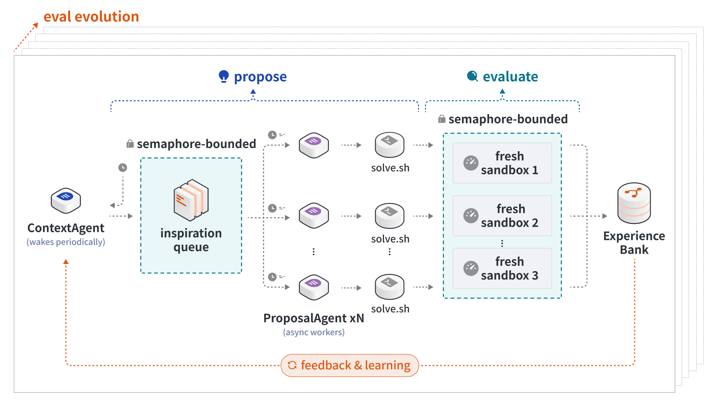

# ReHyra

ReHyra is an independent, clean-room implementation of the recursive discovery
loop described publicly by [Hyra](https://hy.tencent.com/research/hyra).

It is deliberately small: one loop asks a Context Agent what to try, runs fresh
Proposal Agents, evaluates every candidate with an independent evaluator, and
stores the evidence for the next iteration.

ReHyra is not an official Hyra release and is not affiliated with Tencent
Hunyuan. It implements the published architecture, not Hyra's private prompts,
scheduling policy, model settings, or compute budget.

## The algorithm

<p align="center">
  <a href="https://hy.tencent.com/research/hyra">
    
  </a>
</p>

<p align="center"><sub>Hyra Harness diagram from the <a href="https://hy.tencent.com/research/hyra">Hyra Team's public launch article</a>.</sub></p>

ReHyra implements this published loop:

1. The **Context Agent** reads the Experience Bank and prepares promising
   directions in an inspiration queue.
2. Independent **Proposal Agents** turn those directions into candidate
   solutions in fresh workspaces.
3. The **evaluator** runs each candidate, checks qualification, and records its
   score and evidence.
4. Every result returns to the **Experience Bank**, so the next proposals can
   learn from both successes and failures.

The evaluator, not an Agent, decides whether a candidate is better. An optional
outer Architect → Critic loop implements the orange **eval evolution** path:
it can create or improve an evaluator when a task does not already provide a
fixed one.

## Agent runtimes

ReHyra owns the recursive loop; the Agent runtime only executes Context and
Proposal calls. Two native backends are included:

- **Codex** for a tightly integrated coding-Agent runtime.
- **[nanobot](https://github.com/HKUDS/nanobot)**, an open-source,
  ultra-lightweight Agent runtime that can use the same model through a small,
  self-hostable stack.

Both backends receive the same role prompts, fresh workspaces, budgets, and
output contracts. The evaluator and promotion rule do not change, which also
makes runtime ablations possible without changing the task.

Select the runtime in the run configuration:

```toml
# Codex
[agent]
backend = "codex"
model = "gpt-5.6-sol"
reasoning_effort = "high"
```

```toml
# nanobot (install with: pip install nanobot-ai)
[agent]
backend = "nanobot"
model = "your-configured-model"
```

## Repository map

| Path | One responsibility |
|---|---|
| `rehyra/` | Benchmark-neutral recursive search |
| `benchmarks/` | Tasks, examples, results, evidence, and reproduction |
| `codex-plugin/` | Thin Codex Adapter and its skill |
| `tests/` | Model-free behavioral tests |

There is no benchmark or Codex-plugin code inside `rehyra/`. The dependency is
one-way: `codex-plugin/` invokes the ReHyra runtime, never the reverse.
The three dot-prefixed directories at the root are only Codex and GitHub
package metadata.

### Core files

| File | Read it for |
|---|---|
| `rehyra/loop.py` | The complete initialize → propose → evaluate → select loop |
| `rehyra/memory.py` | Experience Bank, attempts, and immutable evidence |
| `rehyra/agents.py` | Context, Proposal, Architect, and Critic roles |
| `rehyra/evaluator.py` | Independent candidate execution and scoring |
| `rehyra/evaluator_evolution.py` | Optional Architect → Critic → replay gate |
| `rehyra/providers.py` | Codex, Nanobot, and generic command adapters |
| `rehyra/contracts.py` | Task and run contracts |

Start with `ReHyraLoop.run()` in `rehyra/loop.py`. The remaining files are
small support modules for prompts, process isolation, task loading, and
filesystem safety.

## Quick start

```bash
git clone https://github.com/Re-bin/rehyra.git
cd rehyra
python -m pip install -e .

python -m unittest discover -s tests
rehyra --help
```

The default suite remains dependency-light and skips checks that require the
optional science stack. Install `.[science]` to exercise those checks too.

## Use ReHyra as a Codex plugin

ReHyra ships as a self-contained Codex plugin. Give it an objective, a
workspace, and an evaluator; it runs a fresh-workspace search campaign and
returns the best candidate it can independently verify.

### Install from GitHub

First, confirm that your Codex installation supports plugins:

```bash
codex plugin --help
```

If Git cannot already read the repository, check your GitHub authentication:

```bash
gh auth status
```

If that check fails, run `gh auth login`. Then let Git use the same
credentials:

```bash
gh auth setup-git
```

Install and verify ReHyra:

```bash
codex plugin marketplace add Re-bin/rehyra --ref main
codex plugin add rehyra@rehyra
codex plugin list
```

Installation succeeded when `codex plugin list` shows `rehyra@rehyra` as
`installed, enabled`.

Refresh Codex and start a new conversation. In ChatGPT or the desktop
composer, select `@ReHyra`. In Codex CLI or the IDE extension, invoke the
bundled skill as `$rehyra`.

### Try it

```text
@ReHyra optimize this workspace for lower benchmark latency without changing
behavior. Use ./bench.py as the evaluator and spend at most four proposals.
```

The evaluator must exit successfully and end stdout with a JSON object such as
`{"qualified": true, "score": 12.3}`. The score must be finite and numeric;
the task declares whether higher or lower is better. ReHyra will ask for
missing information rather than silently inventing an evaluation.

### Install from a local checkout

For plugin development or an offline install, use a clean local clone:

```bash
codex plugin marketplace add /absolute/path/to/rehyra
codex plugin add rehyra@rehyra
codex plugin list
```

Codex copies a local marketplace into its plugin cache. Avoid using a
development checkout containing large ignored `runs/` or `task-data/`
directories.

### What the plugin does

The plugin snapshots the source outside the project, runs ReHyra against a
fixed evaluator, and returns the verified winning workspace and patch. It does
not overwrite the source project unless the user explicitly asks to apply the
winner. Plugin-created tasks use a submission-only mutation policy: Proposal
Agents may explore the snapshot, but every file except the declared submission
is restored from the selected parent before evaluation. Tests and benchmark
code therefore cannot be promoted by rewriting themselves.

The Adapter implementation lives under `codex-plugin/`. The hidden
`.codex-plugin/` and `.agents/` directories at the repository root are only
Codex discovery descriptors.

## Run the Python CLI directly

```bash
python -m pip install -e '.[science]'

rehyra bootstrap-science \
  --output task-data/low-cost-science \
  --tasks erdos_min_overlap \
  --seed-source predecessor \
  --metric-mode auto

rehyra run benchmarks/examples/erdos_codex.toml \
  --run-dir /tmp/rehyra-runs/erdos-001

rehyra status /tmp/rehyra-runs/erdos-001
rehyra validate /tmp/rehyra-runs/erdos-001
```

Completed runs contain `evidence_manifest.json`. Publish its
`root_sha256` with a result and later verify it with:

```bash
rehyra validate /tmp/rehyra-runs/erdos-001 --expected-root <sha256>
```

To use another Agent runtime, change only the provider:

```toml
[agent]
backend = "command"
model = "provider-owned"
command_argv = ["your-agent-adapter", "--non-interactive"]
```

The prompt is sent on standard input. Role, workspace, schema, and output paths
are passed through `HYRA_AGENT_*` environment variables. The full contract is
in [benchmarks/docs/PROVIDERS.md](benchmarks/docs/PROVIDERS.md).

## Security

ReHyra is a research harness, not a security sandbox. Agent and evaluator
processes inherit the launching user's permissions unless you contain them
externally. Use disposable containers or virtual machines for untrusted code,
do not expose long-lived secrets, and review evidence before publication. See
[SECURITY.md](SECURITY.md) for the trust boundary and private reporting
instructions.

## What is implemented

- Persistent Context Agent over the complete Experience Bank.
- Multiple ephemeral Proposal Agents in fresh workspaces.
- Bounded asynchronous scheduling and explicit proposal budgets.
- Fixed, independent evaluators with qualification and objective checks.
- Immutable success, failure, transcript, usage, workspace, and hash evidence.
- A sealed whole-run evidence root with fail-closed offline validation.
- Historical-best preservation, crash recovery, and offline replay.
- Optional Architect → Critic → replay-gated evaluator evolution.
- Codex, Nanobot, and shell-free command providers.
- Adapters for the seven low-cost public Hyra tasks.

## Results at a glance

### Published results: 7/7 independently reproduced

ReHyra re-evaluated Hyra's seven public low-cost artifacts with pinned,
independent evaluators. Arrows show the objective direction.

| Task | Hyra public | ReHyra replay |
|---|---:|---:|
| First Autocorrelation C1 ↓ | 1.502850 | 1.502850 |
| Second Autocorrelation R ↑ | 0.962901 | 0.962901 |
| Erdős Minimum Overlap C5 ↓ | 0.380859 | 0.380859 |
| Sums-vs-Diffs C(A) ↑ | 1.15971 | 1.15971 |
| Qubit Routing added CNOTs ↓ | 258,369 | 258,369 |
| Sunspot R² ↑ | 0.780 | 0.780 |
| Smallest Adder parameters ↓ | 15 | 15 |

### Agent-driven search

| Experiment | Result | What it establishes |
|---|---|---|
| All seven tasks | 7/7 completed Context → Proposal → evaluation → feedback | The complete recursive loop runs across every adapter |
| Sums-vs-Diffs | Best run: **1.1601** vs. Hyra **1.1597**; independent rerun: 1.1492 | One verified win, but not yet a reliable search advantage |
| Sunspot warm continuation | **0.7879**, **0.7847**, and **0.7823** vs. seed 0.7797 | 3/3 one-Proposal runs improved the confirmation score |

Artifact replay verifies the published artifacts and evaluators; it is not
autonomous rediscovery. Likewise, Sunspot demonstrates repeatable
filesystem-causal improvement, not clean temporal generalization, because the
full historical series is public. The repository also passes 79 model-free and
science-adapter tests with sealed evidence validation.

Exact scores, budgets, failures, and evidence hashes are recorded in
[benchmarks/docs/RESULTS.md](benchmarks/docs/RESULTS.md). Exact solution source
and construction bytes are indexed in
[benchmarks/solutions/manifest.toml](benchmarks/solutions/manifest.toml).

## Documentation

- [Method](benchmarks/docs/METHOD.md)
- [Public-spec mapping](benchmarks/docs/HYRA_PUBLIC_SPEC.md)
- [Benchmark protocol](benchmarks/docs/BENCHMARK_PROTOCOL.md)
- [Full results](benchmarks/docs/RESULTS.md)
- [Replication report](benchmarks/docs/REPLICATION_REPORT.md)
- [Provider contract](benchmarks/docs/PROVIDERS.md)

## Citation

If the research architecture influences your work, cite Hyra:

```bibtex
@misc{hyra2026,
  author       = {{Hyra Team}},
  title        = {Hyra: A Simple Yet Effective Scaffold for General Discovery},
  year         = {2026},
  howpublished = {\url{https://hy.tencent.com/research/hyra}}
}
```

## License

ReHyra's original code is licensed under Apache-2.0. Published solution
artifacts retain their upstream or derivation-specific licenses; see
[THIRD_PARTY_NOTICES.md](THIRD_PARTY_NOTICES.md),
[benchmarks/LICENSES/README.md](benchmarks/LICENSES/README.md), and
[benchmarks/solutions/manifest.toml](benchmarks/solutions/manifest.toml).

If you use this implementation, its adapters, or its evidence protocol, cite
ReHyra:

```bibtex
@software{rehyra2026,
  author  = {Xubin Ren},
  title   = {ReHyra: An Open, Clean-Room Implementation of Hyra's Recursive Discovery Loop},
  year    = {2026},
  url     = {https://github.com/Re-bin/rehyra},
  version = {0.3.0}
}
```
